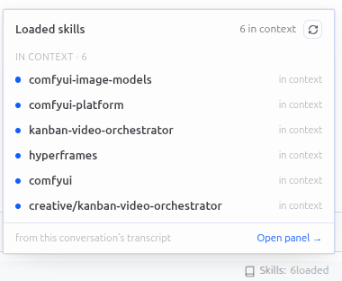
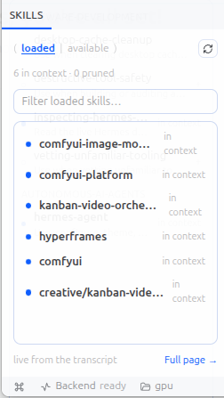
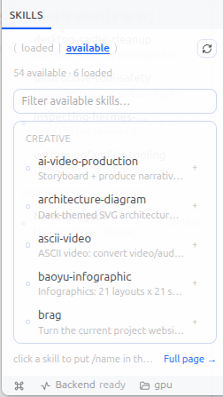

# Loaded Skills Indicator

A Hermes Desktop status-bar chip that answers one question:

> **Which skills are read into this conversation's context right now?**

`Skills: 6 loaded` in the bottom-right cluster. Click it for the list:



| Row | Meaning |
|---|---|
| **bold name**, accent dot, `in context` | the skill body is still in the transcript — the agent can use it without re-reading |
| *ghosted* name, hollow dot, `pruned` | the body was reduced to a `[SKILL_PRUNED: …]` marker by context compression; `skill_view` is needed again |
| *(not listed)* | never loaded in this conversation — the plugin never pads the list with inventory |

`⌘K` → **Skills: open pane** docks the same list beside the conversation
(resizable, closable — re-running the command re-fronts it). The chip's popover
has an **Open pane →** link too, and the pane's footer links to the full-page
view at `/loaded-skills`.

The pane has two views behind a small toggle, `( loaded | available )`:

| View | What it shows |
|---|---|
| **loaded** | the transcript view above — what is in context right now |
| **available** | every skill on disk, grouped by category, with its description and a dot when it is already loaded; click a row and `/<skill>` lands in the composer, ready to send |

 

`⌘K` → **Skills: open all skills** opens the pane straight on the inventory.
Clicking never submits: a click gives you `/name` in the input, and you decide
whether to send it. If the composer is unavailable the command is copied to the
clipboard instead.

## Requirements

- Hermes Agent **0.22.5 or newer** (the desktop SDK surface used —
  `host.openWorkspace`, `host.composer`, `focusedSessionId` — is newer than
  0.21), with the desktop app running.
- No Python dependencies, no API keys, no configuration.
- Built and tested on **Linux** (GNOME/Wayland, Hermes v0.22.5). Everything it
  touches is cross-platform — the desktop SDK, `state.db` and `SKILL.md` files —
  but macOS and Windows are untested by the author.

## Install

From the catalog, once listed:

```bash
hermes plugins install loaded-skills-indicator --enable
```

The desktop half is copied into the app root **opt-in**, like every unified
package: open **Settings → Plugins** and switch **Loaded Skills Indicator** on.
Restart Hermes Desktop if the chip does not appear — the loader caches folders
it has already scanned and only re-reads a folder it has not seen.

From a checkout (development):

```bash
git clone https://github.com/<owner>/loaded-skills-indicator
cd loaded-skills-indicator
ln -s "$PWD" ~/.hermes/plugins/loaded-skills-indicator
hermes plugins enable loaded-skills-indicator --no-allow-tool-override
mkdir -p ~/.hermes/desktop-plugins/loaded-skills-indicator
cp desktop/plugin.js ~/.hermes/desktop-plugins/loaded-skills-indicator/plugin.js
```

`desktop/plugin.js` is a plain file with no build step — re-copy it after
editing (or symlink it) and the app hot-reloads it in place.

### Other profiles

The backend package is per-profile (`$HERMES_HOME/plugins/`): copy the folder
into `~/.hermes/profiles/<name>/plugins/` and enable it there. The desktop half
is app-level and is shared by every profile; without the backend it still works,
in degraded mode (see below).

## Disclosure

What this plugin touches, for anyone deciding whether to install it:

1. **Reads the local transcript.** `dashboard/plugin_api.py` opens the profile's
   `state.db` read-only (`mode=ro`) and reads the ACTIVE message rows of one
   session to decide which skills are still in context. No writes, no other
   tables.
2. **Reads skill files.** The "available" view asks `GET /available`, which reads
   `SKILL.md` frontmatter (name, description, category) under the profile and
   bundled skills directories — nothing else on disk.
3. **Types into your composer.** Clicking an available skill calls
   `host.composer.insertText` with `/<skill> `; it never submits. If that surface
   is missing the command is copied to the clipboard (`ctx.os.writeClipboard`).

No network calls, no telemetry, no credentials, no subprocesses, no self-update
machinery. The plugin never mutates a session, a skill or a config file.

## Why a backend

`session.history` — the only transcript RPC a renderer can call — strips
tool-result bodies except for `write_file` / `patch` / `skill_manage`. So from
the UI alone you can see *that* `skill_view` ran, never whether the body is
still there. `state.db` has the bodies, so `plugin_api.py` reads the ACTIVE
rows (`active = 1`, not compacted) and reduces them to a small list:

- assistant `tool_calls` → `tool_call_id` → the `skill_view` argument name;
- `skill_view` tool row with a body → **full**; with a prune marker → **pruned**;
- `success: false` / `[skill_view] … FAILED` → ignored (nothing was read);
- `/skill`, bundle and auto-load scaffold turns → every skill they name (the
  three scaffold shapes are parsed locally — no import of Hermes internals);
- prune markers in any row's text (compaction summaries) → **pruned**.

The last event for a name wins, so a re-read after a prune goes back to **full**.
The route is read-only, cached for 1.5 s, and tries this request's home, the
default root and every profile's `state.db` — the router can run in a plugin host
whose process home is the launch profile.

The "available" view does not reimplement the agent's view of the library: the
list comes from the gateway's own `skills.manage` RPC (so disabled and
platform-filtered skills stay hidden), and `GET /available` only enriches it with
descriptions. Backend unreachable → names still list, descriptions go missing.

## Degraded mode

If the backend is not reachable (package not enabled for the active profile, or
a gateway that does not serve `/api/plugins/`), the chip falls back to the
display transcript: `skill_view` invocations are still listed and prune markers
are still read, but a pruned body whose marker the summarizer dropped cannot be
told apart from a live one. The footer says so: *"Backend off — display
transcript only"*.

## Behaviour

- Refetches every 5 s, on any gateway event that could touch skills/tools, when
  the focused session changes, and when the window regains focus.
- Follows the focused chat (`host.state.focusedSessionId` /
  `focusedStoredSessionId`), including session tiles.
- Zero skills → `Skills: 0 loaded`, and the popover says nothing is loaded.
- Right-click the status bar to hide the chip (it is listed as **Loaded
  skills**); the ⌘K pane keeps working either way.
- A gateway caches a mounted plugin router, so after a plugin *update* a new
  backend route needs a gateway/app restart before it answers. The UI degrades
  instead of breaking while that is true.

## Layout

```
plugin.yaml, __init__.py       # agent half (inert register stub)
desktop/plugin.js              # the UI: chip, popover, docked pane, page
dashboard/plugin_api.py        # /skills, /available, /health  (FastAPI router)
dashboard/manifest.json        # {"api": "plugin_api.py", "tab": {"hidden": true}}
tests/                         # unittest, no dependencies
```

## Development

```bash
python3 -m unittest discover -s tests -t tests -v   # 18 tests, stdlib only
hermes plugins validate . --install-deps            # the catalog CI gate
```

The tests stub FastAPI's two import-time names, so the router's pure functions
(transcript analysis, `SKILL.md` scanning, scaffold parsing) run anywhere.
